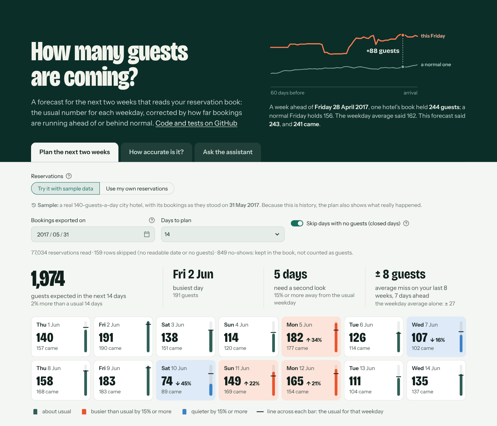
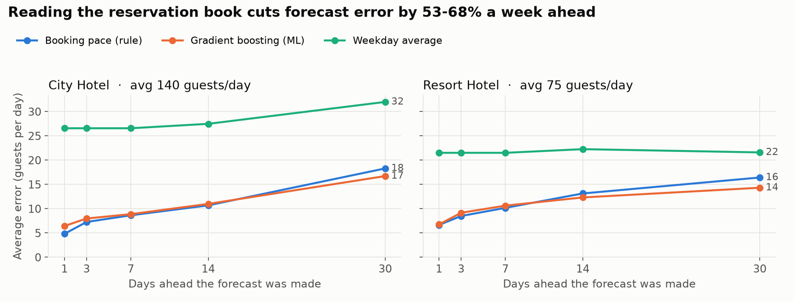
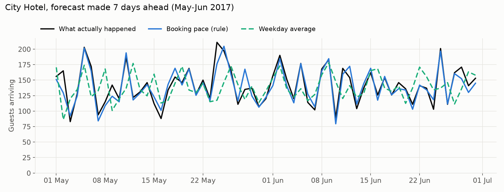

# How many guests are coming? Forecasting demand from the reservation book

[](https://github.com/rebekaolar-cyber/booking-pace-forecast/actions/workflows/tests.yml)


**Upload your reservations export and get the next two weeks: guests per day, a range you can
trust, the days that need a second look, and how many people to schedule.** Behind it is a
forecast that reads the reservation book. On 119,390 real hotel bookings it makes 53-68% smaller
errors a week ahead than the usual weekday average, and it beats a gradient-boosting model up to
7 days out.

**▶ [Use it](#use-it-on-your-own-reservations)** · [Results](#results) · [How it works](#how-it-works) · [Ask the assistant](#ask-the-assistant) · [Run it yourself](#run-it-yourself)



## Use it on your own reservations

1. **Export your reservations** from your booking system (TheFork, Zenchef, Resengo, OpenTable,
   a hotel PMS…) as CSV or Excel: one row per reservation, the last 3 months or more plus
   everything booked ahead. You only need three columns: visit date, number of guests, and the day
   it was made. A cancellation date and a status column make it better. Leave out names and
   contact details; they aren't needed.
2. **Upload it.** Columns are recognised automatically in English and Dutch (`Datum`,
   `Aantal personen`, `Aangemaakt op`, `Geannuleerd op`…), whether the file uses commas or
   semicolons and whether dates have times. Statuses like *cancelled / geannuleerd* and
   *no-show / niet verschenen* are understood. Anything it can't place, you pick from a dropdown.
3. **Read the plan.** For each day you get what's booked so far, the usual for that weekday, the
   forecast, a likely range, a flag on days running 15%+ busier or quieter than usual, and staff
   per role from your own rules (guests per person, with a minimum). Download it as Excel or CSV.

**Every plan is checked on your own data first.** The app replays your last 8 weeks, rebuilding the
book as it stood each morning, and shows how far off the forecast would have been at each distance.
That check sets the likely range: the error that 8 in 10 past days stayed within. On the hotel data,
across 50 different two-week plans, 79-80% of days landed inside the range, so it means what it says.


No file at hand? The app has a sample: a real city hotel's bookings as they stood on 31 May 2017,
shown next to what really happened afterwards.



## Why this matters

Restaurants and hotels decide every day how many people to schedule and how much to order. Most
plan from a fixed weekly pattern ("Fridays are busy"). The reservation book already knows when a
day is going to be unusual, often weeks in advance. This project measures how much that is worth.

## Results

Mean absolute error in **guests per day**. Lower is better. Forecasts for 1 Mar - 31 Aug 2017,
made using only what was known on the morning of the forecast. The ML model was trained on
Jul 2016 - Feb 2017 and never saw the test months.

**City hotel** (140 guests arriving per day on average)

| Days ahead | Weekday average | Same day last year | **Booking pace (rule)** | Gradient boosting (ML) |
|---:|---:|---:|---:|---:|
| 1  | 26.5 | 35.8 | **4.8**  | 6.4 |
| 7  | 26.5 | 35.8 | **8.6**  | 8.9 |
| 14 | 27.5 | 35.8 | **10.7** | 11.0 |
| 30 | 32.0 | 35.8 | 18.3 | **16.7** |

**Resort hotel** (75 guests arriving per day on average)

| Days ahead | Weekday average | Same day last year | **Booking pace (rule)** | Gradient boosting (ML) |
|---:|---:|---:|---:|---:|
| 1  | 21.5 | 28.9 | **6.6** | 6.7 |
| 7  | 21.5 | 28.9 | **10.2** | 10.6 |
| 14 | 22.2 | 28.9 | 13.1 | **12.3** |
| 30 | 21.6 | 28.9 | 16.4 | **14.3** |

All horizons: [`reports/results.md`](reports/results.md).

**What I took from it**

1. **The book is the signal.** Correcting for booking pace cuts the error by 69-82% one day out and
   still by 24-43% a month out.
2. **Simple beats clever up to a week.** The two-line rule beats gradient boosting at every
   horizon from 1 to 7 days, at both hotels. A manager can check it by hand, which matters when it decides who gets a shift.
3. **ML earns its place further out.** A month ahead the book is still thin, and the model's use
   of seasonality and last year pays off: 9-13% better than the rule at 30 days.



## How it works

For a day `d`, standing `h` days before it:

1. **Weekday average.** Average the guests on the last 6 same weekdays that were already over.
2. **Booking pace.** Count the guests in the book for `d` right now. Compare that with what was in
   the book for those 6 earlier days at the same distance before them.
3. **Correct.** Add the difference to the average, capped at ±50% so a single odd group booking
   can't run away with the forecast.


*28 April 2017: a large group was in the book weeks ahead. The weekday average said 162, the
booking pace said 243, and 241 guests came.*

The reservation book is rebuilt from the raw bookings as a `day × days-before` matrix with a
difference array (`src/pace/data.py`), so a booking counts from the day after it was made until it
is cancelled, and the whole 2-year history builds in under a second.

## Proof it's honest

Backtests leak the future easily. These guard against it, and run on every push:

- **The book only shows bookings that existed at forecast time.** A booking made on the forecast
  day itself doesn't change that forecast (`tests/test_book.py`).
- **Cancellations leave the book on their cancellation date. No-shows stay in the book but don't
  count as guests.** Each has a test.
- **Strict time split:** training ends 28 Feb 2017, testing starts 1 Mar 2017.
- **The published numbers are what the code produces.** A test reruns the whole backtest and fails
  if `reports/results.json` differs.
- **An old export can't see the future.** A plan made from an export date gives exactly the same
  answer whether or not later bookings are in the file (`tests/test_plan.py`).

## Inside the app's accuracy tab

The second tab replays the full benchmark: pick a hotel, how far ahead to forecast and any day, and
see the booking curve behind the number.


## Ask the assistant

The third tab is a chat assistant for the manager: "How many bar staff do I need on Saturday?",
"Any unusual days in the next two weeks?", "Wordt het druk aanstaande vrijdag?". It answers in
English or Dutch from the sample hotel's forecast.

- **It can't make numbers up.** The assistant is a plain tool-use loop on the Anthropic Messages
  API, with no framework (`agent/loop.py`). It has five read-only tools over the same forecast
  code as the Plan tab: `get_today_and_data_range`, `get_forecast`, `get_staffing`,
  `get_flagged_days` and `get_accuracy`. Every answer has a "How I got this" box with the tools
  it called, the time, the tokens and the cost.
- **The same tools work in any MCP client.** `agent/mcp_server.py` serves them over the Model
  Context Protocol, for Claude Desktop and others: [`docs/mcp.md`](docs/mcp.md).
- **It is tested like software.** `evals/questions.yaml` holds 50 questions in seven groups:
  single days, date ranges, staffing, Dutch, relative dates ("next Friday"), questions it should
  refuse, and questions about how far to trust the forecast. The main score is number
  faithfulness: every number in an answer must come from a tool result for the day the answer
  is about. That check is plain code, not a second model (`evals/scoring.py`). Tool choice,
  arguments, refusals and answer language are scored too.
- **The live eval guards the main branch.** On every push to `main`, GitHub Actions runs the eval
  with real model calls if an API key is set, and fails the build when any answer contains an
  invented number.

```bash
pip install -r requirements-agent.txt
python -m evals.run                               # demo data, default model and prompt
python -m evals.run --backend real --sample 10    # the real forecast, 10 questions
python -m evals.compare evals/results/A.json evals/results/B.json   # two runs side by side
```

The assistant needs `ANTHROPIC_API_KEY` (in `.streamlit/secrets.toml` or the environment). Without
it the tab says so and switches its input off. The public demo stops at 10 questions per
session and 200 per day.

## Run it yourself

```bash
git clone https://github.com/rebekaolar-cyber/booking-pace-forecast
cd booking-pace-forecast
pip install -r requirements.txt -r requirements-agent.txt -r requirements-dev.txt

PYTHONPATH=src python -m pace.backtest   # rebuilds reports/results.md (about 10 seconds)
PYTHONPATH=src python -m pace.charts     # redraws the three charts
python -m pytest                         # every test; none of them calls the AI service
streamlit run streamlit_app.py           # the app
```

```
src/pace/
  data.py       load bookings, rebuild the reservation book per day
  models.py     weekday average, same day last year, booking-pace rule
  ml.py         gradient boosting on the same signals (scikit-learn)
  backtest.py   replay Mar-Aug 2017 at 1-30 days ahead, write reports/
  charts.py     the README charts
  plan.py       read any reservations export, plan the next days, self-check, staffing
agent/          the assistant: tool definitions, the tool-use loop, MCP server, run log
evals/          50 questions, the scoring code, the runner and a results comparer
prompts/        the assistant's instructions, one file per version
tests/          book rebuilding, no-leakage checks, export reading, reproducible results,
                the assistant loop, the eval scoring, the app itself
streamlit_app.py
app_pages/      assistant.py (the chat tab) and ui.py (the app's look: colours, header,
                calendar of the days ahead, chart style)
static/         the app's two fonts and its icon, served by the app itself
```

## Limits

- **These are hotels, not restaurants.** Hotel guests book further ahead and rarely walk in, so
  the 1-day gain is bigger than a restaurant with walk-ins would see. The 7- and 14-day numbers are
  the fairer comparison.
- **Two hotels, one country, 2015-2017.** The method transfers; the exact percentages may not.
- **Arrivals, not occupancy.** The target is guests arriving per day, the closest equivalent to
  covers per evening in a restaurant.

## Where this is used

The same rule runs every night in a staffing and scheduling system I built for a 254-seat
restaurant in Enschede. There it turns the forecast into staff per role using the manager's own
rules, with a staff app for schedules, shift swaps and clocking in. That repo is private because it
belongs to the restaurant. Screenshots are available on request.

## Data

Antonio, N., de Almeida, A. & Nunes, L. (2019). *Hotel booking demand datasets.* Data in Brief, 22,
41-49. [doi:10.1016/j.dib.2018.11.126](https://doi.org/10.1016/j.dib.2018.11.126). Licensed
[CC BY 4.0](https://creativecommons.org/licenses/by/4.0/). The authors removed all hotel and
customer identifiers. `data/hotels.csv.gz` is the unmodified CSV, gzipped.

Code: MIT licence. Fonts: Bricolage Grotesque and Instrument Sans, both under the SIL Open Font
License 1.1 (licence texts in `static/fonts/`).

---

Built by **Rebeka Olar**, Business Information Technology student at the University of Twente (NL).
Open to remote roles in data, analytics and automation.
