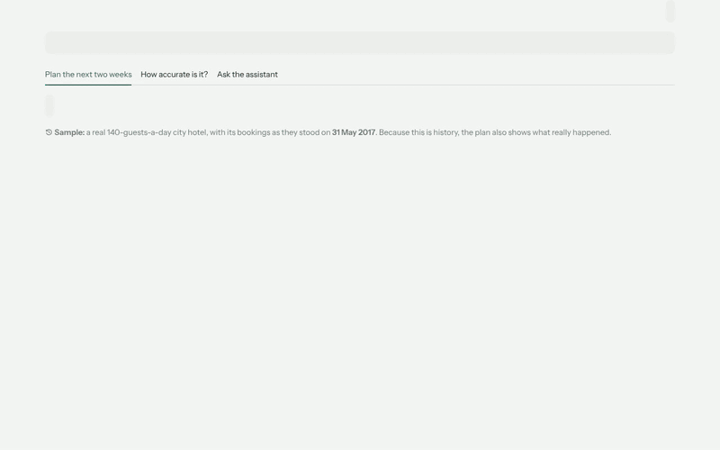
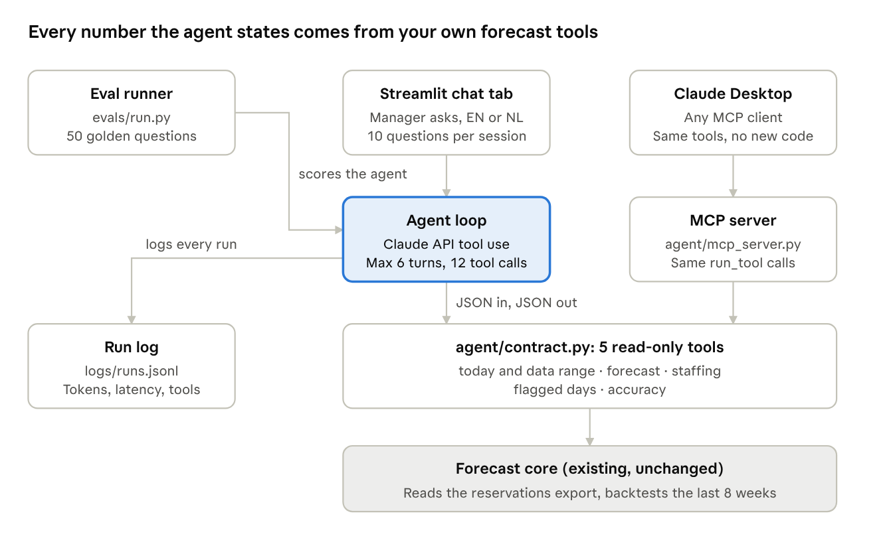
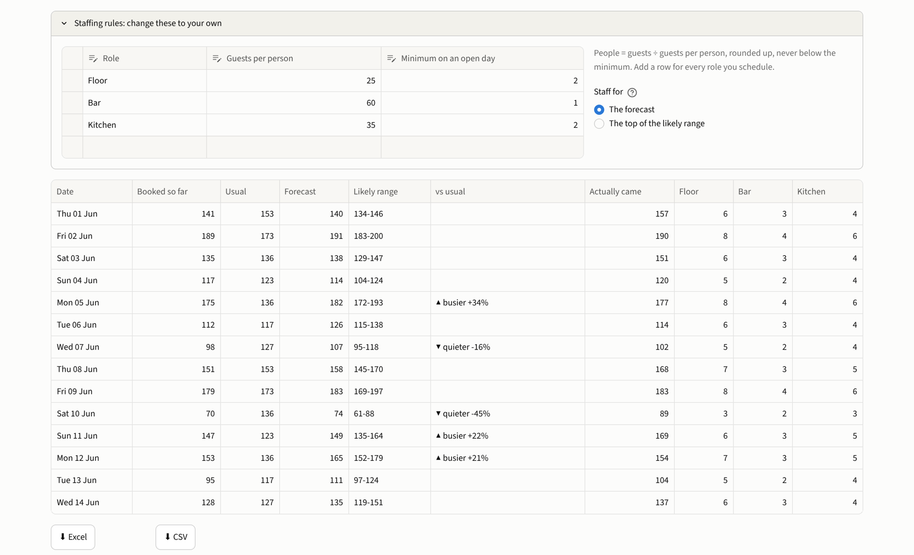
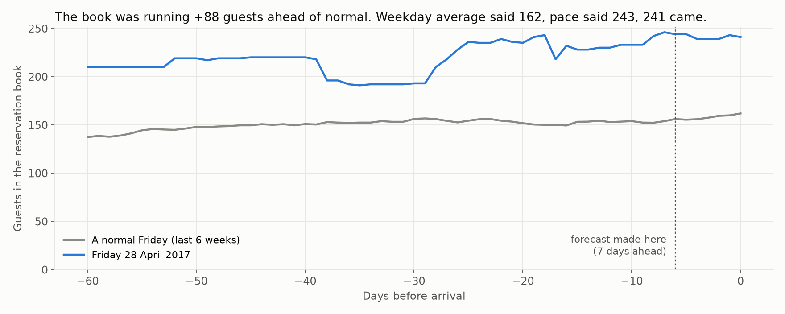
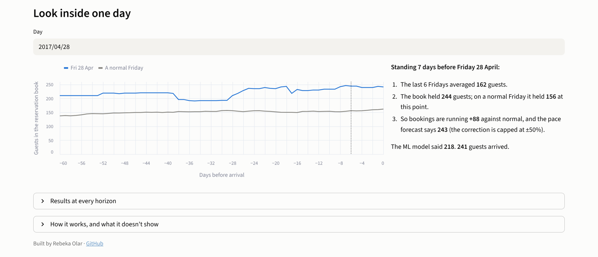

# Booking pace forecast

[](https://github.com/rebekaolar-cyber/booking-pace-forecast/actions/workflows/tests.yml)
[](https://github.com/rebekaolar-cyber/booking-pace-forecast/actions/workflows/eval.yml)

**Upload a reservations export and get the next two weeks: guests per day, a likely range, the
unusual days and how many staff to schedule. Then ask an assistant about it, in English or Dutch.**

The whole app switches between English and Dutch (top right; a link ending in `?lang=nl` opens it in Dutch).

- **A forecast that reads the reservation book.** On 119,390 real hotel bookings, its error 7 days
  ahead is 53-68% smaller than the usual weekday average ([`reports/results.md`](reports/results.md),
  bookings: [`data/README.md`](data/README.md)).
- **An AI assistant that only quotes numbers from the forecast tools.** Claude tool use with five
  read-only tools, in a plain loop with no framework ([`agent/loop.py`](agent/loop.py)). It answers
  about the sample hotel or about the visitor's own uploaded reservations, and streams its answer.
- **An eval that checks it.** 50 questions, a scorer in plain code that traces every number back to
  a tool result, a hand audit of every failure ([report](evals/reports/2026-11-16-live-eval.md)), and
  repeated runs that show which questions pass only sometimes.
- **An MCP server.** The same tools work in Claude Desktop or any other MCP client
  ([`docs/mcp.md`](docs/mcp.md)).

**Live demo:** _deploying — link coming_



## The AI assistant

The app's third tab is a chat assistant for the manager: "How many bar staff do I need on
Saturday?", "Any unusual days in the next two weeks?", "Wordt het druk aanstaande vrijdag?".

- **On the sample hotel** it answers from the city hotel's forecast, where "today" is Thu 1 Jun 2017.
- **On your own reservations:** after an upload on the Plan tab, the assistant tab offers "My
  reservations". The tools then run on exactly what the Plan tab used: the columns you confirmed,
  the export day, your staffing rules, till totals and walk-in estimate
  ([`agent/real_backend.py`](agent/real_backend.py)). Only the forecast numbers the model looks up
  are sent to the API. The file is never written to disk: it stays in the app's memory while you
  use it (cached copies for at most an hour), and the run log keeps no questions, answers or
  numbers from these conversations. Each dataset
  keeps its own conversation, so answers about the sample never leak into questions about your file.



**How a question flows**

1. The question goes to the Claude Messages API with the system prompt
   ([`prompts/v2.md`](prompts/v2.md)), the five tool definitions
   ([`agent/contract.py`](agent/contract.py)) and the last 4 questions and answers, so "and
   Sunday?" works.
2. When the model asks for tools, [`agent/loop.py`](agent/loop.py) runs them through `run_tool`
   and sends the JSON results back. This repeats until the model answers.
3. The tools are read-only: `get_today_and_data_range`, `get_forecast`, `get_staffing`,
   `get_flagged_days` and `get_accuracy`. A bad request (a past date, an unknown role, more than
   28 days) comes back as `{"error": "<plain sentence>"}` that the model can explain.
4. The answer streams onto the page as it is written (`on_text` in the loop; the eval and the MCP
   server don't stream and get the identical result).
5. Every answer shows a "How I got this" box with the tools called, the time, the tokens and the
   cost. When a call fails, the box names the likely cause (no credits, a rejected key, rate limit,
   overload) and shows the API's error, which also goes to the app log. Every run is logged to
   `logs/runs.jsonl` ([`agent/run_log.py`](agent/run_log.py)).

**Guardrails**

- **Numbers only from tools.** The prompt allows only numbers from a tool result in the same
  conversation, and no totals or averages the model works out itself.
- **Ranges, not single numbers.** A forecast is always given with its likely range (low-high).
  Percentages are quoted exactly, to one decimal, so a day never sounds flagged when it isn't.
- **The question's language.** An English question gets an English answer, a Dutch one a Dutch
  answer.
- **Out of scope gets a short no.** Pricing, other businesses, past dates or dates beyond the
  forecast: it says what it can answer instead.
- **Caps.** At most 6 model calls and 12 tool calls per question, and 700 output tokens per call
  ([`agent/loop.py`](agent/loop.py)). The chat tab allows 10 questions per session and 200 per day
  across all sessions ([`app_pages/assistant.py`](app_pages/assistant.py)).

**Three real answers**

These come from the first full live run (Haiku, prompt v1,
[`2026-11-16_haiku_v1.txt`](evals/reports/logs/2026-11-16_haiku_v1.txt)). The scorer of that day
failed them on false alarms. The hand audit found them correct, and the current scorer passes them
([`tests/test_live_eval_v1.py`](tests/test_live_eval_v1.py) replays them). The CI logs print only
failed answers, so answers that passed the first time are not stored in the repo.

*English.* "How many bar staff do I need on Saturday 3 June 2017?"

> Sat 3 Jun: you need **3 bar staff**.
>
> - Forecast: 138 guests (likely range 129–147)
> - Rule: 1 bar staff per 60 guests, rounded up
>
> Based on: staffing rules, forecast.

Tools: `get_today_and_data_range`, `get_staffing {"date": "2017-06-03", "role": "bar"}`,
`get_forecast {"start_date": "2017-06-03", "end_date": "2017-06-03"}`

*Dutch, and a refusal.* "Hoeveel gasten verwachten we op 15 juli 2017?" (How many guests do we
expect on 15 July 2017?)

> Ik kan voor **za 15 jul 2017** geen gastenaantal geven. Mijn voorspelling reikt tot en met **wo 28 jun 2017**, want vandaag is do 1 jun 2017.
>
> Ik kan wel de verwachting geven voor elke dag tot en met 28 jun, inclusief de bandbreedte. Wil je dat?
>
> Gebaseerd op: datumbereik van de data.

Tools: `get_today_and_data_range`. 15 July is past the 28-day horizon, so it declines and offers
any day up to 28 June instead.

*"How sure are you?"* "How sure are you about the forecast for Saturday 17 June 2017?"

> **Sat 17 Jun: forecast 157 guests, likely range 141-173.**
>
> - 154 guests are already booked.
> - The usual for a Saturday is 136, so this day is flagged busy (+15.9%).
> - Confidence is moderate. The day is about two weeks out. In backtests at 14 days ahead, the average error was 10.6 guests, and the 80% range was ±16 guests. Weekday averages missed by about 26.5 guests, so the forecast is much better than a typical-Saturday guess.
> - Caution: over the 14 days after the export, only 64% of actual results landed inside the range, below the 80% target. Treat the range as a bit optimistic.
>
> Based on: forecast, accuracy check.

Tools: `get_today_and_data_range`, `get_forecast {"start_date": "2017-06-17", "end_date": "2017-06-17"}`,
`get_accuracy`

## How well it works

Live runs on 16 Nov 2026: 50 questions each, real forecast, scored by the current scorer. Every
failed answer was then checked by hand. An earlier v1 run, scored before 16 scorer fixes, is left
out because it is not comparable. All numbers below are copied from
[`evals/reports/2026-11-16-live-eval.md`](evals/reports/2026-11-16-live-eval.md); the full CI output
is in [`evals/reports/logs/`](evals/reports/logs/).

| | Haiku, prompt v1 | Haiku, prompt v2 | Sonnet, prompt v2 |
|---|---|---|---|
| Passed all checks | 38/50 (76%) | 43/50 (86%) | 39/50 (78%) |
| Every number traced to a tool | 40/50 (80%) | 44/50 (88%) | 42/50 (84%) |
| Right tools called | 49/50 (98%) | 50/50 (100%) | 48/50 (96%) |
| Refused when it should | 7/8 (88%) | 8/8 (100%) | 6/8 (75%) |
| Answered in the question's language | 49/50 (98%) | 49/50 (98%) | 50/50 (100%) |
| Answers with a real mistake (by hand) | 4/50, plus 2 unclear | 4/50 | 2/50, plus 2 unclear |
| Answers with a wrong or invented number (by hand) | 0/50, plus 1 unclear | 1/50 | 2/50 |
| Latency p95 | 5.546 s | 5.964 s | 6.213 s |
| Cost per 100 questions | $0.0871 | $0.0888 | $1.5430 |

Models: `claude-haiku-5-5` and `claude-sonnet-5-5`. Cost is worked out from the token counts and the
list prices in [`agent/run_log.py`](agent/run_log.py).

**What I found.** The model almost never invents numbers: by hand, 0 to 2 answers in 50 had a wrong
number, and each of those was a wrong count of flagged days, with every per-day number right. The
automated pass rate rose from v1 to v2 (38 to 43), but the hand-checked real mistakes did not
change (4 and 4); most of the gap was scorer false alarms. Haiku did about as well as Sonnet at about
1/17 of the cost: 4 against 2 real mistakes and 1 against 2 wrong numbers is within run-to-run
variation, so these runs do not show either model to be more accurate. The real mistakes
were counting flagged days wrong, English questions answered partly or fully in Dutch (Haiku
only), staffing numbers worked out by the model itself, and garbled words ("минимaal",
"nanaast"). The caveat: 50 questions and one run per setup, so a difference of a few answers is
within run-to-run variation, and only failed answers were checked by hand.

**What the scorer checks** ([`evals/scoring.py`](evals/scoring.py), plain code, no second model)

- **Every number is traced.** Each number in the answer must match a tool output for the day the
  sentence is about, a value that holds for every day (such as accuracy), or a number from the
  question.
- **The right tools, with the right arguments.** Compared with the expected calls for each question.
- **Refusals.** Out-of-scope questions must get a clear decline.
- **Language.** The answer must be in the question's language.
- **The key numbers are there.** The answer must contain the numbers the question is about,
  recomputed from the same tools at eval time.

**Known limits.** The scorer is a text check, not a judge, so it misses some mistakes and flags
some correct answers:

- A sentence that names no day is checked against every day of the run, so a number from the wrong
  day can pass there.
- Counts of days are only checked in the forms "N busy/flagged days" and "N of the M days are
  below usual / flagged / closed" (M must be the days a tool returned, N those in that state).
  "Two are busy" (there were 3) passed.
- Short date lists ("Wed 7, Sat 10 and Fri 16 Jun"), the 80% target wording and the 15% threshold
  wording still cause false alarms.
- Dutch fragments in an English answer, wrong weekday labels and garbled words are not caught.
- Numbers repeated from the question always pass, even with another meaning.

**Run it again**

```bash
python -m evals.run --backend real --prompt v2            # needs ANTHROPIC_API_KEY
python -m evals.run --backend real --sample 10 --repeat 3  # same questions 3 times: how stable?
python -m evals.run                                       # demo forecast data, still calls the model
python -m evals.compare evals/results/A.json evals/results/B.json   # two runs side by side
```

In GitHub Actions, [`eval.yml`](.github/workflows/eval.yml) runs the live eval on every push to
`main` when the `ANTHROPIC_API_KEY` secret is set. Run it by hand from the Actions tab
(workflow_dispatch) with four inputs: `sample` (number of questions, default 10), `model`
(default `claude-haiku-5-5`), `prompt` (default `v2`) and `repeat` (how many times to ask the same
questions, default 1). It fails the build when a run ends in an
error or fewer than 80% of answers have every number traced. Flags above that line show up as
warnings on the run, to check by hand, because the scorer still has the false alarms listed above.

## The forecast

### Use it on your own reservations

1. **Export your reservations** from your booking system (TheFork, Zenchef, Resengo, OpenTable, a
   hotel PMS) as CSV or Excel: one row per reservation, the last 3 months or more plus everything
   booked ahead. Three columns are enough: visit date, number of guests and the day it was made. A
   cancellation date and a status column make it better. Names and contact details aren't needed.
2. **Upload it.** Columns are recognised in English and Dutch (`Datum`, `Aantal personen`,
   `Aangemaakt op`, `Geannuleerd op`), with commas or semicolons, with or without times. Statuses
   like *cancelled / geannuleerd* and *no-show / niet verschenen* are understood. Anything it
   can't place, you pick from a dropdown.
3. **Say what kind of place it is.** A hotel's guests nearly all book ahead. A restaurant also gets
   walk-ins, so the app adds an estimate on top of the reservations: by default walk-ins are 40% of
   all guests on Friday to Sunday and 20% Monday to Thursday, and you can change both. At 40%, 60
   guests expected from reservations become 100 in total. If your file already lists walk-ins, or
   you upload real daily totals from your till, nothing is added.
4. **Read the plan.** For each day: booked so far, the usual for that weekday, the forecast, a
   likely range, a flag on days 15% or more busier or quieter than usual, and staff per role from
   your own rules. Download it as Excel or CSV.

Every plan is checked on your own data first. The app replays your last 8 weeks, rebuilding the
book as it stood each morning, and shows how far off the forecast would have been at each
distance. The likely range is the error that 8 in 10 of those past days stayed within.



No file at hand? The app has a sample: a real city hotel's bookings as they stood on 31 May 2017,
shown next to what really happened afterwards.

### Why this matters

Restaurants and hotels decide every day how many people to schedule and how much to order. Most
plan from a fixed weekly pattern ("Fridays are busy"). The reservation book often shows weeks in
advance that a day will be unusual. This project measures how much that is worth.

### Results

Mean absolute error in **guests per day**, lower is better. Forecasts for 1 Mar - 31 Aug 2017, made
only from what was known on the morning of the forecast. The ML model was trained on Jul 2016 -
Feb 2017 and never saw the test months. Source: [`reports/results.md`](reports/results.md) and
[`reports/results.json`](reports/results.json).

**City hotel** (140 guests arriving per day on average)

| Days ahead | Weekday average | Same day last year | **Booking pace (rule)** | Gradient boosting (ML) |
|---:|---:|---:|---:|---:|
| 1  | 26.5 | 35.8 | **4.8**  | 6.4 |
| 7  | 26.5 | 35.8 | **8.6**  | 8.9 |
| 14 | 27.5 | 35.8 | **10.7** | 11.0 |
| 30 | 32.0 | 35.8 | 18.3 | **16.7** |

**Resort hotel** (75 guests arriving per day on average)

| Days ahead | Weekday average | Same day last year | **Booking pace (rule)** | Gradient boosting (ML) |
|---:|---:|---:|---:|---:|
| 1  | 21.5 | 28.9 | **6.6** | 6.7 |
| 7  | 21.5 | 28.9 | **10.2** | 10.6 |
| 14 | 22.2 | 28.9 | 13.1 | **12.3** |
| 30 | 21.6 | 28.9 | 16.4 | **14.3** |


1. **The book is the signal.** Correcting for booking pace cuts the error by 69-82% one day out and
   still by 24-43% a month out.
2. **Simple beats clever up to a week.** The two-line rule beats gradient boosting at every horizon
   from 1 to 7 days, at both hotels. A manager can check it by hand, which matters when it decides
   who gets a shift.
3. **ML earns its place further out.** A month ahead the book is still thin, and the model's use of
   seasonality and last year pays off: 9-13% better than the rule at 30 days.


### How it works

For a day `d`, standing `h` days before it ([`src/pace/models.py`](src/pace/models.py)):

1. **Weekday average.** Average the guests on the last 6 same weekdays that are already over.
2. **Booking pace.** Count the guests in the book for `d` now. Compare that with what was in the
   book for those 6 earlier days at the same distance before them.
3. **Correct.** Add the difference to the average, capped at ±50% so one odd group booking can't
   run away with the forecast.



*28 April 2017, 7 days ahead: a large group was already in the book. The weekday average said
162, the booking pace said 243, and 241 guests came ([`reports/forecasts.csv.gz`](reports/forecasts.csv.gz)).*

The reservation book is rebuilt from the raw bookings as a `day × days-before` matrix with a
difference array ([`src/pace/data.py`](src/pace/data.py)). A booking counts from the day after it
was made until it is cancelled.

### Proof it's honest

Backtests leak the future easily. These checks guard against it and run on every push:

- **The book only shows bookings that existed at forecast time.** A booking made on the forecast
  day itself doesn't change that forecast ([`tests/test_book.py`](tests/test_book.py)).
- **Cancellations leave the book on their cancellation date. No-shows stay in the book but don't
  count as guests.** Each has a test.
- **Strict time split:** training ends 28 Feb 2017, testing starts 1 Mar 2017.
- **The published numbers are what the code produces.** A test reruns the whole backtest and fails
  if `reports/results.json` differs.
- **An old export can't see the future.** A plan made from an export date gives the same answer
  whether or not later bookings are in the file ([`tests/test_plan.py`](tests/test_plan.py)).

The app's second tab replays the full benchmark: pick a hotel, a distance and any day, and see the
booking curve behind the number.



### Limits

- **These are hotels, not restaurants.** Hotel guests book further ahead and rarely walk in, so
  the 1-day gain is bigger than a restaurant with walk-ins would see. The 7- and 14-day numbers are
  the fairer comparison.
- **The restaurant walk-in estimate is a fixed share, not a forecast.** The 40% and 20% defaults are
  assumptions, not measured here, and the likely range only covers the reservations part. Real
  daily totals from the till replace the estimate with what really happened.
- **Two hotels, one country, 2015-2017.** The method transfers; the exact percentages may not.
- **Arrivals, not occupancy.** The target is guests arriving per day, the closest match to covers
  per evening in a restaurant.

### Where this is used

The same rule runs every night in a staffing and scheduling system I built for a restaurant in
Enschede. There it turns the forecast into staff per role from the manager's own rules, with a
staff app for schedules, shift swaps and clocking in. That repo is private because it belongs to
the restaurant.

## Run it yourself

```bash
git clone https://github.com/rebekaolar-cyber/booking-pace-forecast
cd booking-pace-forecast
pip install -r requirements.txt -r requirements-agent.txt -r requirements-dev.txt

streamlit run streamlit_app.py           # the app, three tabs
python -m pytest -q                      # 444 tests, none of them calls the API
PYTHONPATH=src python -m pace.backtest   # rebuilds reports/results.md
PYTHONPATH=src python -m pace.charts     # redraws the charts
```

**API key for the assistant.** Put it in `.streamlit/secrets.toml`:

```toml
ANTHROPIC_API_KEY = "..."
```

or set the `ANTHROPIC_API_KEY` environment variable. `secrets.toml` is in `.gitignore` and is never
committed. Without a key the chat tab says so and switches its input off; the other two tabs work.

**MCP server.** `python -m agent.mcp_server` serves the five tools over stdio. Add
`BPF_BACKEND=fake` for demo data. Claude Desktop setup: [`docs/mcp.md`](docs/mcp.md).

## Project layout

```
agent/            the assistant
  contract.py       the five read-only tools and run_tool
  loop.py           the tool-use loop on the Messages API
  real_backend.py   the tools on the real forecast; fake_backend.py for tests
  mcp_server.py     the same tools over MCP
  run_log.py        one JSON line per run, with token cost
app_pages/        assistant.py (chat tab), ui.py (the app's look), demo_assistant.py
evals/            questions.yaml (50 questions), scoring.py, run.py, compare.py
  reports/          the hand-audited live eval and its CI logs
prompts/          v1.md, v2.md: the assistant's instructions, one file per version
src/pace/         the forecast
  data.py           load bookings, rebuild the reservation book per day
  models.py         weekday average, same day last year, booking-pace rule
  ml.py             gradient boosting on the same signals (scikit-learn)
  backtest.py       replay Mar-Aug 2017 at 1-30 days ahead, write reports/
  charts.py         the README charts
  plan.py           read any reservations export, plan, self-check, staffing
tests/            no-leakage checks, export reading, reproducible results, the loop,
                  the scorer, the MCP server, the app itself
docs/             screenshots, architecture.png, mcp.md
reports/          benchmark results and charts
data/             the hotel booking dataset
static/           the app's fonts and icon
streamlit_app.py  the app
```

---

Built by **Rebeka Olar**, Business Information Technology student at the University of Twente (NL).
The agent layer (assistant, MCP server and eval) was built with Claude Code; I designed and
reviewed it.

**Data:** Antonio, N., de Almeida, A. & Nunes, L. (2019). *Hotel booking demand datasets.* Data in
Brief, 22, 41-49. [doi:10.1016/j.dib.2018.11.126](https://doi.org/10.1016/j.dib.2018.11.126).
Licensed [CC BY 4.0](https://creativecommons.org/licenses/by/4.0/). The authors removed all hotel
and customer identifiers. `data/hotels.csv.gz` is the unmodified CSV, gzipped.

Code: MIT licence. Fonts: Bricolage Grotesque and Instrument Sans, both under the SIL Open Font
License 1.1 (licence texts in `static/fonts/`).
